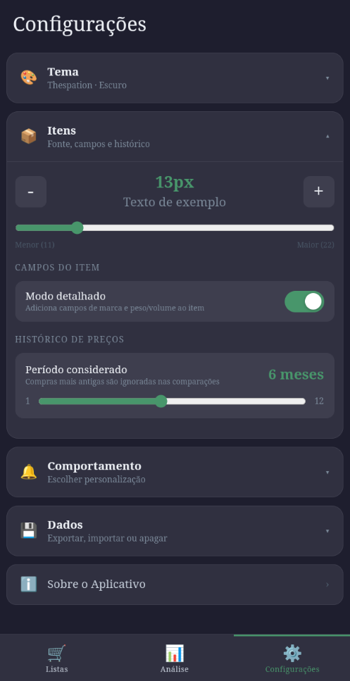
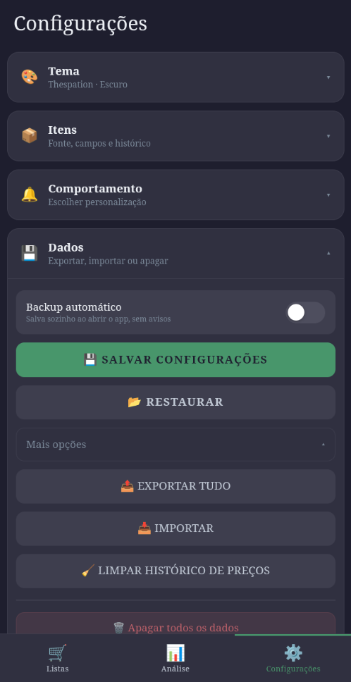

# 🛒 Lista de Compras

> **[🇺🇸 Read in English](README_EN.md)**

<div align="center">


</div>

Aplicativo Android nativo para gerenciar listas de compras com histórico de preços, análise de gastos e múltiplas paletas de cores. Funciona **100% offline** — nenhum dado sai do celular.

---

## 📸 Screenshots

| Listas | Análise Anual | Análise Mensal |
|:---:|:---:|:---:|
|  |  |  |
| Cards de resumo, busca por histórico de preço, listas do mês e meses anteriores agrupados | Total do ano, mês mais caro/barato e gráfico horizontal por mês | Total do mês, comparação com mês anterior e itens acima da média |

| Análise Produtos | Configurações — Tema | Configurações — Itens |
|:---:|:---:|:---:|
|  |  |  |
| Histórico por produto com marca/peso, recorrência, preço médio e variação | Escuro/Claro, paletas predefinidas e personalizadas, ocultar/restaurar temas | Tamanho da fonte, modo detalhado (marca/peso) e período do histórico de preços |

| Configurações — Comportamento | Configurações — Dados | Sobre |
|:---:|:---:|:---:|
|  |  |  |
| Alerta de reposição, toque tátil, posição da barra e botão voltar | Backup automático, salvar/restaurar e mais opções | Versão, desenvolvedor, contato e verificação de atualizações |

---

## 📱 Download e Instalação

1. Acesse a página de [Releases](https://github.com/thespation/lista-compras-android/releases)
2. Baixe o arquivo `app-release.apk`
3. No Android: **Configurações → Segurança → Instalar apps desconhecidos** → ative para o gerenciador de arquivos
4. Abra o APK e toque em **Instalar**

> **Requisito mínimo:** Android 5.1 (API 22)

---

## ✨ Funcionalidades

### 🛒 Listas de Compras

- **Criar listas** com nome, data e mercado selecionável
- **Data editável** — toque no cabeçalho para editar nome, mercado e data; permite criar rascunhos e definir a data no dia real da compra
- **Basear em lista anterior** — ao criar nova lista, copie os produtos de uma lista existente com preços zerados
- **Listas Futuras** — seção colapsável para listas com data futura, com indicador visual, separada do mês atual
- **Organização por mês** — mês atual expandido; meses anteriores agrupados por ano/mês, cada um colapsável
- **Duplicar lista** — copia todos os itens para uma nova lista, com opção de zerar valores e trocar mercado
- **Mercados ordenados por uso** — os mais usados aparecem primeiro ao criar uma lista
- **Busca de histórico de preço** — pesquise qualquer item (por nome ou marca) para ver o histórico completo com data, mercado, valor e variação
- **Card "Este mês" clicável** — navega direto para a Análise Mensal do mês atual
- **Remover lista** — com confirmação para evitar exclusão acidental

### 📦 Itens da Lista

- **Adicionar itens** com nome, quantidade e preço
- **Modo detalhado (opcional)** — campos extras de marca e peso/volume (kg, g, L, ml, unidade), com autocompletar de marca e capitalização automática
- **Edição em lote de produto** — em Análise → Produtos, atualize nome, marca e peso de um produto em todas as listas de uma vez
- **Capitalização automática** — nomes salvos com a primeira letra maiúscula
- **Nomes longos** — quebra de linha automática
- **Autocompletar** — sugere nomes já usados (com marca/peso quando preenchidos), indica quando o item já está na lista e preenche automaticamente marca/peso/quantidade da compra mais recente
- **Alerta de duplicata** — aviso ao adicionar um item que já está na lista
- **Comparação de preço automática** — mostra ▼ mais barato ou ▲ mais caro em relação à última compra daquele produto
- **Quantidade editável** — ao tocar no campo de quantidade, o valor é selecionado automaticamente
- **Estimativa de gasto** — quando há itens sem preço, o total exibe "≈ TOTAL"
- **Marcar/desmarcar** itens comprados com checkbox e toque tátil configurável
- **Editar item** — toque no ✏️ para corrigir nome, quantidade, preço, marca ou peso
- **Ordenação** por 6 critérios: inserção, alfabética, preço, marcados primeiro/último
- **Filtro de variação** — exibir só os itens mais baratos ou mais caros
- **Total no topo ou rodapé** — escolha se a barra de marcados+total fica no topo ou fixada no rodapé
- **Exportar lista** — como texto formatado (agrupado em "a comprar"/"comprados" com subtotal) ou como arquivo para importar em outro celular; ambos compartilháveis via WhatsApp, e-mail, etc.
- **Marcar todos / Desmarcar todos** de uma vez

### 📊 Análise de Gastos

- **Resumo geral** — card fixo no topo com total do ano, mês anterior (ou última compra) e este mês com indicador ▲/▼
- **Gastos por ano** — gráfico horizontal por mês com destaque do mês mais caro e mais barato; toque em uma barra para navegar ao mês
- **Gastos por mês** — total mensal, gasto por mercado com barra visual, comparação com período anterior e itens acima da média histórica
- **Produtos** — histórico de preços, recorrência, variação, ranking completo de mercados por preço e filtros por período/mercado/ordenação; produtos com a mesma marca são diferenciados automaticamente, sem duplicar itens legados sem marca
- **Alerta de reposição** — sugere itens comprados regularmente que ainda não aparecem no mês atual; cada sugestão pode ser removida individualmente

### ⚙️ Configurações

Seções em ordem: **Tema → Itens → Comportamento → Dados → Sobre o Aplicativo**

#### Tema
- **Escuro/Claro**
- **7 paletas de cores**, cada uma com modo escuro e claro:
  - 🟡 **Dourado** — clássica e elegante
  - 🔵 **Nórdica** — ártico e limpa (Nord)
  - 🟤 **Gruvbox** — retrô e quente
  - 🌸 **Rosé Pine** — suave e floral
  - 🟣 **Catppuccin** — pastel techno
  - ⚫ **Meia-Noite** — OLED, preto absoluto `#000000`
  - 📄 **Papel** — tinta sobre papel, branco puro `#ffffff`
- **Ocultar temas** — botão ✕ em cada tema predefinido; restauração em linha única colapsável
- **🎨 Paleta personalizada** — crie sua própria paleta com prévia em tempo real

#### Itens
- **Tamanho da fonte** — de 11px a 22px com slider e botões +/−
- **Modo detalhado** — ativa campos de marca e peso/volume ao adicionar ou editar itens
- **Histórico de preços** — período considerado nas comparações (1 a 12 meses)

#### Comportamento
- **Sugestão de itens frequentes** — sugere itens comprados regularmente que ainda não estão no mês atual
- **Vibração ao marcar item** — pulso tátil ao marcar/desmarcar um produto
- **Posição da barra de navegação** — acima (topo) ou abaixo (base da tela)
- **Botão voltar** na tela inicial — perguntar antes de sair, minimizar o app ou não fazer nada

#### Dados
- **Backup automático** — ativar/desativar + frequência (mensal, trimestral, semestral, anual); roda silenciosamente ao abrir o app, sem notificações
- **💾 Salvar configurações** — snapshot local com data e hora
- **📂 Restaurar** — lista, restaura ou exclui backups salvos
- **Mais opções** (retrátil):
  - **📤 Exportar tudo** — salvar localmente ou compartilhar (WhatsApp, e-mail, Drive, etc.)
  - **📥 Importar** — seleciona um arquivo exportado; faz backup automático antes de sobrescrever
  - **🧹 Limpar histórico de preços** — remove entradas de itens que não existem em nenhuma lista atual (com confirmação)
- **🗑 Apagar todos os dados** — faz backup automático antes, com confirmação

### 🔄 Atualizações
- Botão **"Verificar atualização"** na tela Sobre — consulta o GitHub e exibe o changelog com formatação (negrito, títulos, listas)
- Download do APK mais recente com um toque
- Verificação manual, sem consumo de dados em background

---

## 🗂️ Estrutura do Projeto

```
lista-compras-android/
├── android/                          # Projeto Android Studio
│   ├── app/
│   │   ├── build.gradle              # Config do módulo (AGP 8.3.2, compileSdk 34) + assinatura de release
│   │   └── src/main/
│   │       ├── AndroidManifest.xml   # Permissões: INTERNET e VIBRATE; FileProvider para compartilhamento
│   │       ├── assets/public/
│   │       │   └── index.html        # App completo embutido
│   │       ├── java/com/listacompras/app/
│   │       │   └── MainActivity.java # WebView + AndroidBridge
│   │       └── res/
│   │           ├── mipmap-*/         # Ícones em todas as densidades
│   │           ├── xml/              # Configuração do FileProvider
│   │           └── values/themes.xml # Tema sem interferência na status bar
│   ├── gradle/wrapper/
│   │   └── gradle-wrapper.properties # Gradle 8.5
│   └── keystore/                     # Keystore de assinatura (não versionada — ver .gitignore)
├── src/
│   └── App.jsx                       # Código-fonte React
├── Imagens/                          # Screenshots do app
├── README.md                         # Este arquivo (pt-BR)
└── README_EN.md                      # Versão em inglês
```

---

## 🔧 Tecnologias Utilizadas

| Tecnologia | Versão | Função |
|---|---|---|
| **React** | 18.x | Interface de usuário |
| **JavaScript (JSX)** | ES2017+ | Lógica da aplicação |
| **esbuild** | latest | Bundler — compila e minifica o JSX |
| **Android WebView** | — | Container nativo para o app web |
| **Java** | 17 | MainActivity, AndroidBridge, FileProvider |
| **Gradle** | 8.5 | Build system Android |
| **Android Gradle Plugin** | 8.3.2 | Plugin de build Android |
| **AndroidX Core** | 1.12.0 | Suporte a FileProvider (compartilhamento de arquivos) |
| **localStorage** | Web API | Persistência de dados e backups |

> Sem frameworks externos, sem banco de dados, sem servidor. Dados salvos 100% no dispositivo.

---

## 🏗️ Arquitetura

O app é uma **Single Page Application (SPA)** React compilada com esbuild em um único arquivo `index.html`. Esse arquivo é carregado por uma `WebView` Android nativa.

### Identificação de produtos

Produtos são agrupados por nome; marca e peso/volume só diferenciam produtos quando há um conflito real entre valores preenchidos (duas marcas diferentes, por exemplo). Itens sem marca (registros antigos ou modo simples) são automaticamente unidos ao produto correspondente, evitando duplicidade na Análise.

### Bridge Java ↔ JavaScript

```javascript
window.__androidDarkMode             // boolean — tema do sistema Android
window.__androidBack                 // function — handler do botão voltar
window.AndroidBridge.openUrl(url)    // abre URL no navegador externo
window.AndroidBridge.exitApp()       // fecha o app
window.AndroidBridge.minimizeApp()   // minimiza para segundo plano
window.AndroidBridge.vibrate(ms)     // vibração tátil (Android 8+)
window.AndroidBridge.share(text)     // compartilhamento nativo de texto
window.AndroidBridge.shareFile(name, content)  // compartilha conteúdo como arquivo real (via FileProvider)
window.AndroidBridge.saveFile(name, content)   // abre o seletor "Salvar como" do Android
window.AndroidBridge.pickFile()      // abre o seletor de arquivos para importação
```

### Persistência (localStorage)

| Chave | Conteúdo |
|---|---|
| `lista-compras-v2` | Listas, itens e histórico de preços |
| `lista-compras-settings` | Configurações do usuário |
| `lista-compras-backups` | Índice dos backups |
| `lista-compras-backup-{timestamp}` | Dados de cada backup individual |

---

## 🎮 Navegação — Botão Voltar (Android)

Comportamento em cascata:
1. Fecha qualquer modal ou dropdown aberto
2. Fecha accordion aberto em Configurações
3. Recolhe detalhes expandidos em Análise → Produtos
4. Dentro de uma lista → volta para Listas
5. Em Análise ou Configurações → volta para Listas
6. Na tela Sobre → volta para Configurações
7. Na tela inicial → comportamento configurável (perguntar, minimizar ou nada)

---

## 👨‍💻 Desenvolvedor

**William Santos**
- GitHub: [@thespation](https://github.com/thespation)
- E-mail: thespation@gmail.com

---

## 📄 Licença

Este projeto é de uso pessoal. Sinta-se livre para usar como referência ou base para projetos próprios.
