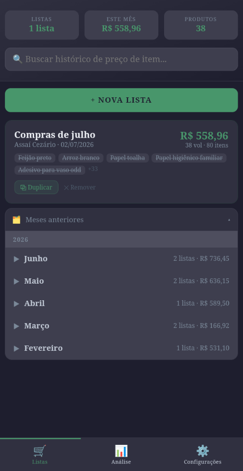
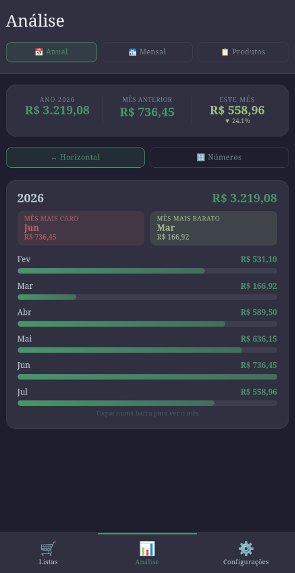
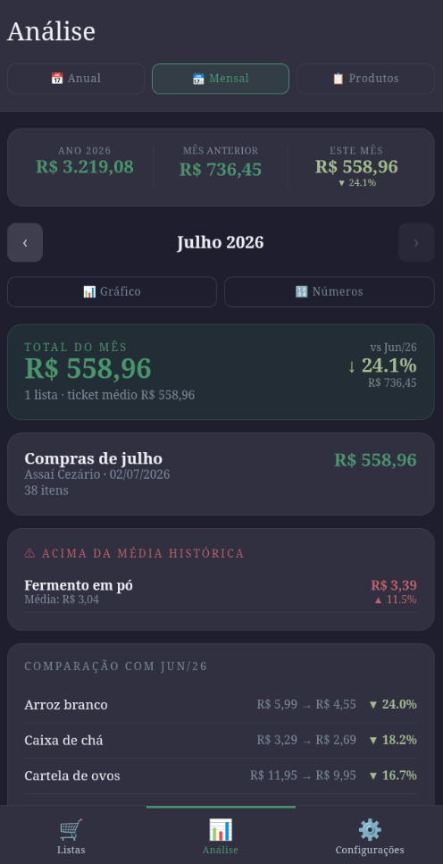
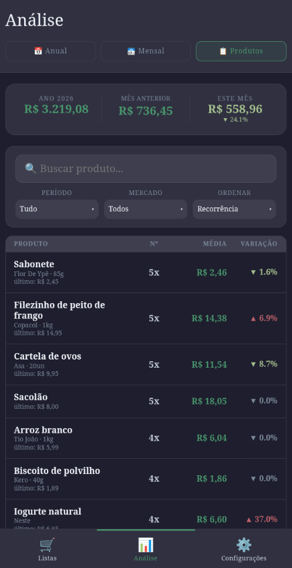
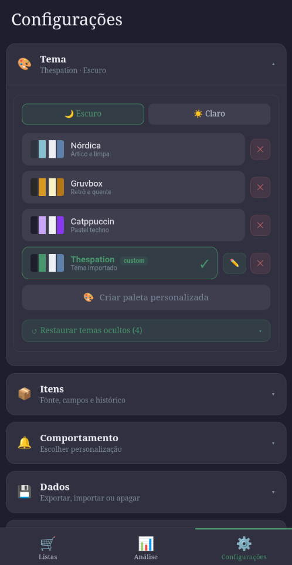
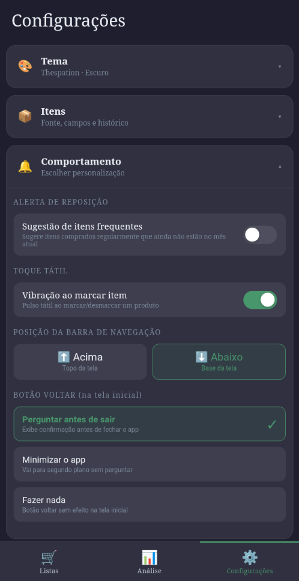
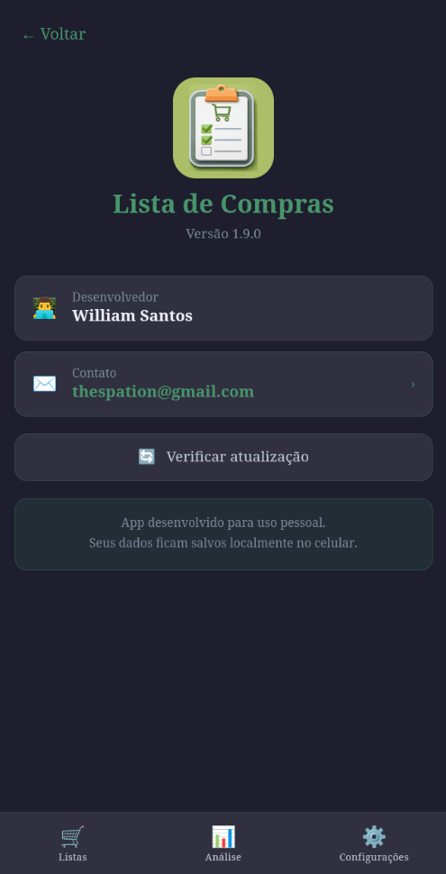

# 🛒 Lista de Compras

> **[🇺🇸 Read in English](README_EN.md)**

<div align="center">


</div>

Aplicativo Android nativo para gerenciar listas de compras com histórico de preços, análise de gastos e múltiplas paletas de cores. Funciona **100% offline** — nenhum dado sai do celular (a única conexão é a verificação de atualização, que só acontece quando você toca no botão).

---

## 📸 Screenshots

| Listas | Análise Anual | Análise Mensal |
|:---:|:---:|:---:|
|  |  |  |
| Cards de resumo, busca por histórico de preço, listas do mês e meses anteriores agrupados | Total do ano, mês mais caro/barato e gráfico horizontal por mês | Total do mês, comparação com mês anterior e itens acima da média |

| Análise Produtos | Configurações — Tema | Configurações — Itens |
|:---:|:---:|:---:|
|  |  |  |
| Histórico por produto com marca/peso, recorrência, preço médio, variação e linha do tempo de preço | Escuro/Claro, paletas predefinidas e personalizadas, estilo de ícones, ocultar/restaurar temas | Tamanho da fonte, zoom opcional, modo detalhado (marca/peso) e período do histórico de preços |

| Configurações — Comportamento | Configurações — Dados | Sobre |
|:---:|:---:|:---:|
|  |  |  |
| Alerta de reposição, vibração, deslizar para marcar, posição da barra e botão voltar | Backup automático e lembrete, salvar/restaurar, exportar (backup e planilha), importar e armazenamento | Versão, desenvolvedor, contato e verificação de atualizações |

<!--
CAPTURAS NOVAS SUGERIDAS (adicione os arquivos na pasta Imagens/ e remova este comentário para exibir):

| Importar — O que importar? | Linha do tempo de preço | Ícones minimalistas |
|:---:|:---:|:---:|
|  |  |  |
| Escolha listas por mês, paletas e grupos de configurações antes de importar | Gráfico das compras de um produto ao longo do tempo, com menor, média e maior preço | Estilo de traço fino, na cor do tema (escuro e claro) |

| Exportar planilha (CSV) | Deslizar para marcar | Lembrete de backup |
|:---:|:---:|:---:|
|  |  |  |
| Escolha das listas por mês; salvar ou compartilhar | Deslize o item para o lado para marcar ou desmarcar | Aviso na tela inicial quando faz tempo que não há backup em arquivo |
-->

---

## 📱 Download e Instalação

1. Acesse a página de [Releases](https://github.com/thespation/lista-compras-android/releases)
2. Baixe o arquivo `app-release.apk`
3. No Android: **Configurações → Segurança → Instalar apps desconhecidos** → ative para o gerenciador de arquivos
4. Abra o APK e toque em **Instalar**

> **Requisito mínimo:** Android 5.1 (API 22). Alguns recursos dependem da versão do Android: ícone adaptativo (8+), ícone monocromático/temático (13+).

### 🔄 Atualizando

- Instale o novo APK **por cima** da versão atual: listas, backups e configurações são mantidos. Antes de atualizar, vale exportar um backup (**Configurações → Dados → Mais opções → Exportar tudo**).
- **A partir da 1.10.4**, na primeira abertura depois de atualizar o app **migra seus dados automaticamente** para um novo endereço interno, conferindo tudo e sem apagar nada do local antigo (se algo falhar, o app continua como antes). Um aviso confirma quando termina.
- Depois de migrar, **não volte para versões anteriores**: elas mostrariam os dados de antes da migração.
- Em **Configurações → Dados → Mais opções → Armazenamento** você vê o estado da migração e pode **recuperar a cópia de segurança** guardada pelo Android.

---

## ✨ Funcionalidades

### 🛒 Listas de Compras

- **Criar listas** com nome, data e mercado selecionável
- **Data editável** — toque no cabeçalho para editar nome, mercado e data; permite criar rascunhos e definir a data no dia real da compra
- **Basear em lista anterior** — ao criar nova lista, copie os produtos de uma lista existente com preços zerados
- **Listas Futuras** — seção colapsável para listas com data futura, com indicador visual, separada do mês atual
- **Organização por mês** — mês atual expandido; meses anteriores agrupados por ano/mês, cada um colapsável
- **Duplicar lista** — copia todos os itens para uma nova lista, com opção de zerar valores e trocar mercado
- **Mercados ordenados por uso** — os mais usados aparecem primeiro ao criar uma lista
- **Busca de histórico de preço** — pesquise qualquer item (por nome ou marca) para ver o histórico completo com data, mercado, valor e variação
- **Card "Este mês" clicável** — navega direto para a Análise Mensal do mês atual
- **Remover lista** — com confirmação para evitar exclusão acidental

### 📦 Itens da Lista

- **Adicionar itens** com nome, quantidade e preço
- **Modo detalhado (opcional)** — campos extras de marca e peso/volume (kg, g, L, ml, unidade), com autocompletar de marca e capitalização automática
- **Edição em lote de produto** — em Análise → Produtos, atualize nome, marca e peso de um produto em todas as listas de uma vez
- **Capitalização automática** — nomes salvos com a primeira letra maiúscula
- **Nomes longos** — quebra de linha automática
- **Autocompletar** — sugere nomes já usados (com marca/peso quando preenchidos), indica quando o item já está na lista e preenche automaticamente marca/peso/quantidade da compra mais recente
- **Alerta de duplicata** — aviso ao adicionar um item que já está na lista
- **Comparação de preço automática** — mostra ▼ mais barato ou ▲ mais caro em relação à última compra daquele produto
- **Quantidade editável** — ao tocar no campo de quantidade, o valor é selecionado automaticamente
- **Estimativa de gasto** — quando há itens sem preço, o total exibe "≈ TOTAL"
- **Marcar/desmarcar** itens comprados com checkbox e vibração configurável
- **Deslizar para marcar/desmarcar (opcional)** — deslize o item para o lado, em qualquer direção; aparece "✓ Marcar" ou "Desmarcar" atrás da linha e só vale se você soltar depois do limite. A rolagem da lista continua normal. Liga/desliga em **Configurações → Comportamento**
- **Editar item** — toque no lápis para corrigir nome, quantidade, preço, marca ou peso
- **Ordenação** por 6 critérios: inserção, alfabética, preço, marcados primeiro/último
- **Filtro de variação** — exibir só os itens mais baratos ou mais caros
- **Total no topo ou rodapé** — escolha se a barra de marcados+total fica no topo ou fixada no rodapé
- **Exportar lista** — como texto formatado (agrupado em "a comprar"/"comprados" com subtotal) ou como arquivo para importar em outro celular; ambos compartilháveis via WhatsApp, e-mail, etc.
- **Marcar todos / Desmarcar todos** de uma vez

### 📊 Análise de Gastos

- **Resumo geral** — card fixo no topo com total do ano, mês anterior (ou última compra) e este mês com indicador ▲/▼
- **Gastos por ano** — gráfico horizontal por mês com destaque do mês mais caro e mais barato; toque em uma barra para navegar ao mês
- **Gastos por mês** — total mensal, gasto por mercado com barra visual, comparação com período anterior e itens acima da média histórica
- **Produtos** — histórico de preços, recorrência, variação, ranking completo de mercados por preço e filtros por período/mercado/ordenação; produtos com a mesma marca são diferenciados automaticamente, sem duplicar itens legados sem marca
- **Linha do tempo de preço** — ao abrir um produto, um gráfico mostra todas as compras do período ao longo do tempo (eixo proporcional às datas), com linhas de menor preço, média e maior preço; tocar ou segurar um ponto mostra data, mercado e preço
- **Alerta de reposição** — sugere itens comprados regularmente que ainda não aparecem no mês atual; cada sugestão pode ser removida individualmente

### ⚙️ Configurações

Seções em ordem: **Tema → Itens → Comportamento → Dados → Sobre o Aplicativo**

#### Tema
- **Escuro/Claro**
- **7 paletas de cores**, cada uma com modo escuro e claro:
  - 🟡 **Dourado** — clássica e elegante
  - 🔵 **Nórdica** — ártico e limpa (Nord)
  - 🟤 **Gruvbox** — retrô e quente
  - 🌸 **Rosé Pine** — suave e floral
  - 🟣 **Catppuccin** — pastel techno
  - ⚫ **Meia-Noite** — OLED, preto absoluto `#000000`
  - 📄 **Papel** — tinta sobre papel, branco puro `#ffffff`
- **Ocultar temas** — botão ✕ em cada tema predefinido; restauração em linha única colapsável
- **🎨 Paleta personalizada** — crie sua própria paleta com prévia em tempo real
- **Ícones** — **Clássicos** (emojis) ou **Minimalistas** (SVG de traço fino, na cor do tema: claros no escuro, escuros no claro, inclusive nas paletas personalizadas)
- As barras do sistema (status e navegação) e o fundo da janela seguem o tema escolhido, e o app já abre na cor certa, sem flash branco

#### Itens
- **Tamanho da fonte** — de 11px a 22px com slider e botões +/−
- **Zoom com dois dedos** — opcional, para acessibilidade (desligado por padrão, para não ampliar sem querer)
- **Modo detalhado** — ativa campos de marca e peso/volume ao adicionar ou editar itens
- **Histórico de preços** — período considerado nas comparações (1 a 12 meses)

#### Comportamento
- **Sugestão de itens frequentes** — sugere itens comprados regularmente que ainda não estão no mês atual
- **Vibração ao marcar item** — pulso tátil ao marcar/desmarcar um produto
- **Deslizar para marcar** — liga/desliga o gesto de deslizar o item para marcar ou desmarcar
- **Posição da barra de navegação** — acima (topo) ou abaixo (base da tela)
- **Botão voltar** na tela inicial — perguntar antes de sair, minimizar o app ou não fazer nada

#### Dados
- **Backup automático** — ativar/desativar + frequência (mensal, trimestral, semestral, anual); roda silenciosamente ao abrir o app, sem notificações
- **Lembrete de backup em arquivo** — a tela inicial avisa quando faz 30 dias que você não exporta um backup (ou nunca exportou e já tem listas antigas), com "Exportar agora" e "Lembrar em 7 dias"; a data do último backup em arquivo aparece aqui, e o lembrete pode ser desligado
- **💾 Salvar configurações** — snapshot local com data e hora
- **📂 Restaurar** — lista, restaura ou exclui backups salvos
- **Mais opções** (retrátil):
  - **📤 Exportar tudo** — backup completo; salvar localmente ou compartilhar (WhatsApp, e-mail, Drive, etc.)
  - **📊 Exportar planilha (CSV)** — escolha as listas (por mês ou uma a uma) e salve ou compartilhe um arquivo para Excel/Planilhas Google: uma linha por item, com data, lista, mercado, produto, marca, quantidade, peso/unidade, preço unitário, total e se estava marcado (separador `;`, vírgula decimal, acentos corretos; textos que pareceriam fórmulas são protegidos). A planilha não conta como backup
  - **📥 Importar — "O que importar?"** — ao importar um arquivo (ou restaurar um backup), você escolhe o que entra:
    - **listas**, agrupadas por mês (o mês inteiro ou lista por lista);
    - **paletas personalizadas**, uma a uma;
    - **configurações por grupo**: tema ativo (inclui o estilo de ícones), paletas ocultas, mercados, fonte/posição das abas/zoom, comportamento, reposição e histórico, backup automático e lembrete;
    - **modo**: *adicionar às minhas listas* ou *substituir todas as minhas listas*; para listas que já existem: *pular*, *substituir* ou *importar como cópia*;
    - mostra um resumo antes de confirmar e sempre salva um backup automático dos dados atuais; arquivos com partes inválidas não quebram o app (o que não presta é ignorado e você é avisado)
  - **Armazenamento** — endereço do app, estado da migração de dados e **Recuperar cópia da migração** (abre "O que importar?" com a cópia de segurança guardada pelo Android)
- **🗑 Apagar todos os dados** — faz backup automático antes, com confirmação

### ♿ Acessibilidade
- **TalkBack e teclado** — caixinhas dos itens com estado e nome (também com Espaço/Enter), botão de editar com o nome do item, botões ✕ com o nome da ação, seções que abrem/fecham informando se estão abertas ou fechadas, e emojis decorativos escondidos do leitor de tela
- **Zoom com dois dedos** opcional e **tamanho da fonte** ajustável
- **Ícones** — adaptativo (Android 8+) e monocromático para os "ícones temáticos" (Android 13+)

### 🔄 Atualizações
- Botão **"Verificar atualização"** na tela Sobre — consulta o GitHub (compara os números da versão) e exibe o changelog com formatação (negrito, títulos, listas)
- Download do APK mais recente com um toque
- Verificação manual, sem consumo de dados em background

---

## 🛠️ Compilando o projeto

Requisitos: **Android Studio** recente (ou JDK 17–21 + Android SDK 34) e internet na primeira compilação (para baixar as dependências). O guia completo, com a solução dos erros mais comuns, está em [`COMO-COMPILAR.txt`](COMO-COMPILAR.txt).

1. Abra a pasta **`android`** no Android Studio.
2. **Gradle JDK**: em *Settings → Build, Execution, Deployment → Build Tools → Gradle*, escolha **jbr-21** (ou um JDK 17/21). Um JDK mais novo (como o 25) causa o erro *"Incompatible Gradle JVM version"* com o Gradle 8.5.
3. **Assinatura**: o projeto assina o `debug` e o `release` com a mesma chave, que **não está no repositório**. Crie a sua:
   ```bash
   keytool -genkeypair -v -keystore android/keystore/lista-compras-release.keystore -alias lista-compras -keyalg RSA -keysize 2048 -validity 10000
   ```
   e crie `android/keystore/keystore.properties` com `storePassword=...`, `keyAlias=lista-compras` e `keyPassword=...` (ou defina a variável de ambiente `LC_KEYSTORE_PASSWORD`). Esses dois arquivos ficam fora do git (`.gitignore`). Um APK assinado com outra chave **não atualiza por cima** do APK oficial: é preciso desinstalar antes.
4. Gere o APK (dentro da pasta `android`):
   ```bash
   ./gradlew assembleRelease      # Windows: gradlew.bat assembleRelease
   ```
   O arquivo sai em `android/app/build/outputs/apk/release/app-release.apk` (o release usa R8; o `assembleDebug` gera um APK sem otimização).

> O `index.html` em `assets/public` é o resultado da compilação de `src/App.jsx` (React 18 + esbuild, em um único arquivo). O script que o gera não faz parte deste repositório.

---

## 🗂️ Estrutura do Projeto

```
lista-compras-android/
├── android/                          # Projeto Android Studio
│   ├── app/
│   │   ├── build.gradle              # Config do módulo (AGP 8.3.2, compileSdk 34), R8 no release e assinatura
│   │   ├── proguard-rules.pro        # Protege a ponte JavaScript ↔ Java no R8
│   │   └── src/main/
│   │       ├── AndroidManifest.xml   # Permissões: INTERNET e VIBRATE; FileProvider para compartilhamento
│   │       ├── assets/public/
│   │       │   └── index.html        # App completo embutido (gerado a partir de src/App.jsx)
│   │       ├── java/com/listacompras/app/
│   │       │   ├── MainActivity.java # WebView, WebViewAssetLoader e AndroidBridge
│   │       │   └── MigrationStore.java # Cópia verificada dos dados durante a migração
│   │       └── res/
│   │           ├── mipmap-*/         # Ícones (normal, redondo, adaptativo e monocromático)
│   │           ├── mipmap-anydpi-v26/# Definição do ícone adaptativo
│   │           ├── values/           # Cores e tema (sem interferência na status bar)
│   │           └── xml/              # Configuração do FileProvider
│   ├── gradle/wrapper/               # Gradle Wrapper (Gradle 8.5)
│   ├── gradlew, gradlew.bat          # Compilar sem instalar o Gradle
│   └── keystore/                     # Chave de assinatura (não versionada — ver .gitignore)
├── src/
│   └── App.jsx                       # Código-fonte React
├── Imagens/                          # Screenshots do app
├── COMO-COMPILAR.txt                 # Guia de compilação e solução de erros
├── README.md                         # Este arquivo (pt-BR)
└── README_EN.md                      # Versão em inglês
```

---

## 🔧 Tecnologias Utilizadas

| Tecnologia | Versão | Função |
|---|---|---|
| **React** | 18.x | Interface de usuário |
| **JavaScript (JSX)** | ES2017+ | Lógica da aplicação |
| **esbuild** | latest | Bundler — compila e minifica o JSX |
| **Android WebView** | — | Container nativo para o app web |
| **Java** | 17 | MainActivity, AndroidBridge, MigrationStore, FileProvider |
| **Gradle** | 8.5 | Build system Android (JDK 17–21) |
| **Android Gradle Plugin** | 8.3.2 | Plugin de build Android |
| **AndroidX Core** | 1.12.0 | Suporte a FileProvider (compartilhamento de arquivos) |
| **AndroidX WebKit** | 1.10.0 | WebViewAssetLoader (endereço https interno do app) |
| **R8** | — | Encolhe o APK de release |
| **localStorage** | Web API | Persistência de dados e backups |

> Sem frameworks externos de interface, sem banco de dados, sem servidor. Dados salvos 100% no dispositivo.

---

## 🏗️ Arquitetura

O app é uma **Single Page Application (SPA)** React compilada com esbuild em um único arquivo `index.html`. Esse arquivo é carregado por uma `WebView` Android nativa.

### Endereço interno e migração de dados

A partir da 1.10.4 o app é servido por `WebViewAssetLoader` em `https://appassets.androidplatform.net/assets/public/index.html` (endereço interno, sem internet; as versões anteriores usavam `file:///android_asset/...`). Como o `localStorage` é separado por endereço, na primeira abertura os dados são **copiados** do endereço antigo para o novo:

1. no endereço antigo, o app lê todas as chaves e entrega ao Android, que grava uma cópia em arquivo (`MigrationStore`, gravação atômica) e **confere**;
2. só então abre o endereço novo e importa a cópia **sem sobrescrever** nada que já exista, conferindo cada chave; se algo falhar, desfaz tudo e volta ao endereço antigo (até 3 tentativas);
3. nada é apagado do endereço antigo, e a cópia fica guardada pelo Android (recuperável em *Dados → Mais opções → Armazenamento*).

### Identificação de produtos

Produtos são agrupados por nome; marca e peso/volume só diferenciam produtos quando há um conflito real entre valores preenchidos (duas marcas diferentes, por exemplo). Itens sem marca (registros antigos ou modo simples) são automaticamente unidos ao produto correspondente, evitando duplicidade na Análise. O histórico de preços é calculado a partir das próprias listas.

### Bridge Java ↔ JavaScript

```javascript
window.__androidDarkMode             // boolean — tema do sistema Android
window.__androidBack                 // function — handler do botão voltar
window.__flushSave                   // function — grava os dados na hora (o Android chama em onPause)
window.__onFilePicked(content)       // o Android entrega o conteúdo do arquivo escolhido
window.__onFileSaved                 // o Android avisa que um backup em arquivo foi gravado
window.AndroidBridge.openUrl(url)    // abre URL no navegador externo (só http, https e mailto)
window.AndroidBridge.exitApp()       // fecha o app
window.AndroidBridge.minimizeApp()   // minimiza para segundo plano
window.AndroidBridge.vibrate(ms)     // vibração tátil
window.AndroidBridge.share(text)     // compartilhamento nativo de texto
window.AndroidBridge.shareFile(name, content)           // backup (JSON) como arquivo real (via FileProvider)
window.AndroidBridge.shareTextFile(name, mime, content) // planilha CSV ou texto como arquivo
window.AndroidBridge.saveFile(name, content)            // seletor "Salvar como" do Android (backup)
window.AndroidBridge.saveTextFile(name, mime, content)  // "Salvar como" para CSV ou texto
window.AndroidBridge.pickFile()      // abre o seletor de arquivos para importação
window.AndroidBridge.setThemeColors(bg, nav, escuro)    // cores das barras do sistema e do fundo da janela
window.AndroidBridge.migrationStatus() // + migrationExport/Get/Done/Info/...: migração de dados (1.10.4+)
```

### Persistência (localStorage)

| Chave | Conteúdo |
|---|---|
| `lista-compras-v2` | Listas e itens |
| `lista-compras-settings` | Configurações do usuário |
| `lista-compras-backups` | Índice dos backups internos |
| `lista-compras-backup-{timestamp}` | Dados de cada backup individual |
| `lista-compras-migracao` | Marcador da migração de dados (1.10.4+) |

---

## 🎮 Navegação — Botão Voltar (Android)

Comportamento em cascata:
1. Fecha qualquer modal ou dropdown aberto
2. Fecha accordion aberto em Configurações
3. Recolhe detalhes expandidos em Análise → Produtos
4. Dentro de uma lista → volta para Listas
5. Em Análise ou Configurações → volta para Listas
6. Na tela Sobre → volta para Configurações
7. Na tela inicial → comportamento configurável (perguntar, minimizar ou nada)

---

## 👨‍💻 Desenvolvedor

**William Santos**
- GitHub: [@thespation](https://github.com/thespation)
- E-mail: thespation@gmail.com

---

## 📄 Licença

Este projeto é de uso pessoal. Sinta-se livre para usar como referência ou base para projetos próprios.
