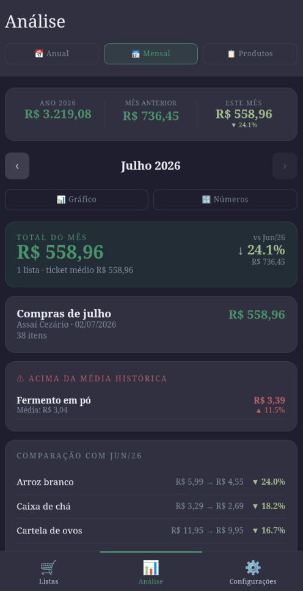

# 🛒 Shopping List

> **[🇧🇷 Ler em Português](README.md)**

<div align="center">


</div>

Native Android app for managing shopping lists with price history, spending analysis, and multiple color palettes. Works **100% offline** — no data ever leaves the phone.

---

## 📸 Screenshots

| Lists | Annual Analysis | Monthly Analysis |
|:---:|:---:|:---:|
|  |  |  |
| Summary cards, price history search, current month's lists and collapsible previous months | Yearly total, most/least expensive month and horizontal bar chart per month | Monthly total, comparison with previous month and items above historical average |

| Products Analysis | Settings — Theme | Settings — Items |
|:---:|:---:|:---:|
|  |  |  |
| Per-product history with brand/weight, purchase count, average price and variation | Dark/Light mode, built-in and custom palettes, hide/restore themes | Font size, detailed mode (brand/weight) and price history period |

| Settings — Behavior | Settings — Data | About |
|:---:|:---:|:---:|
|  |  |  |
| Restock alert, haptic feedback, nav bar position and back button | Automatic backup, save/restore and more options | Version, developer, contact and update checker |

---

## 📱 Download and Installation

1. Go to the [Releases](https://github.com/thespation/lista-compras-android/releases) page
2. Download the `app-release.apk` file
3. On Android: **Settings → Security → Install unknown apps** → enable it for your file manager
4. Open the APK and tap **Install**

> **Minimum requirement:** Android 5.1 (API 22)

---

## ✨ Features

### 🛒 Shopping Lists

- **Create lists** with name, date, and selectable market
- **Editable date** — tap the header to edit name, market, and date; allows drafting lists and setting the actual purchase date later
- **Base on a previous list** — when creating a new list, copy items from an existing list with prices reset to zero
- **Future Lists** — collapsible section for lists dated in the future, with a visual indicator, kept separate from the current month
- **Organized by month** — current month expanded; previous months grouped by year/month, each collapsible
- **Duplicate list** — copies all items into a new list, with the option to reset prices and change the market
- **Markets sorted by usage** — most-used markets appear first when creating a list
- **Price history search** — search any item (by name or brand) to see its full history with date, market, price, and variation
- **Clickable "This month" card** — jumps straight to Monthly Analysis for the current month
- **Delete list** — with confirmation to prevent accidental deletion

### 📦 List Items

- **Add items** with name, quantity, and price
- **Detailed mode (optional)** — extra fields for brand and weight/volume (kg, g, L, ml, unit), with brand autocomplete and automatic capitalization
- **Bulk product editing** — in Analysis → Products, update a product's name, brand, and weight across all lists at once
- **Automatic capitalization** — names are saved with the first letter capitalized
- **Long names** — automatic line wrapping
- **Autocomplete** — suggests previously used names (with brand/weight when filled in), flags when the item is already on the list, and auto-fills brand/weight/quantity from the most recent purchase
- **Duplicate alert** — warning when adding an item already on the list
- **Automatic price comparison** — shows ▼ cheaper or ▲ more expensive compared to that product's last purchase
- **Editable quantity** — tapping the quantity field selects its value automatically
- **Spending estimate** — when items are missing a price, the total shows "≈ TOTAL"
- **Check/uncheck** purchased items with a checkbox and configurable haptic feedback
- **Edit item** — tap ✏️ to fix name, quantity, price, brand, or weight
- **Sorting** by 6 criteria: insertion order, alphabetical, price, checked first/last
- **Variation filter** — show only items that got cheaper or more expensive
- **Total at top or bottom** — choose whether the checked-count+total bar stays at the top or fixed at the bottom
- **Export list** — as formatted text (grouped into "to buy"/"purchased" with subtotal) or as a file to import on another phone; both shareable via WhatsApp, email, etc.
- **Check all / Uncheck all** at once

### 📊 Spending Analysis

- **Overview card** — fixed at the top with yearly total, previous month (or last purchase), and this month with a ▲/▼ indicator
- **Yearly spending** — horizontal bar chart per month, highlighting the most and least expensive months; tap a bar to jump to that month
- **Monthly spending** — monthly total, spending per market with a visual bar, comparison with the previous period, and items above their historical average
- **Products** — price history, recurrence, variation, full market ranking by price, and filters by period/market/sorting; products with the same brand are automatically differentiated, without duplicating legacy items missing a brand
- **Restock alert** — suggests regularly purchased items that haven't appeared this month yet; each suggestion can be dismissed individually

### ⚙️ Settings

Sections in order: **Theme → Items → Behavior → Data → About the App**

#### Theme
- **Dark/Light**
- **7 color palettes**, each with dark and light modes:
  - 🟡 **Golden** — classic and elegant
  - 🔵 **Nordic** — arctic and clean (Nord)
  - 🟤 **Gruvbox** — retro and warm
  - 🌸 **Rosé Pine** — soft and floral
  - 🟣 **Catppuccin** — pastel techno
  - ⚫ **Midnight** — OLED, absolute black `#000000`
  - 📄 **Paper** — ink on paper, pure white `#ffffff`
- **Hide themes** — ✕ button on each built-in theme; restore via a single collapsible row
- **🎨 Custom palette** — build your own palette with a live preview

#### Items
- **Font size** — from 11px to 22px with a slider and +/− buttons
- **Detailed mode** — enables brand and weight/volume fields when adding or editing items
- **Price history** — how far back comparisons look (1 to 12 months)

#### Behavior
- **Suggest frequent items** — suggests regularly purchased items that aren't in the current month yet
- **Vibrate on check** — haptic pulse when checking/unchecking a product
- **Navigation bar position** — top or bottom of the screen
- **Back button** on the home screen — ask before exiting, minimize the app, or do nothing

#### Data
- **Automatic backup** — enable/disable + frequency (monthly, quarterly, biannual, yearly); runs silently when the app opens, no notifications
- **💾 Save settings** — local snapshot with date and time
- **📂 Restore** — list, restore, or delete saved backups
- **More options** (collapsible):
  - **📤 Export everything** — save locally or share (WhatsApp, email, Drive, etc.)
  - **📥 Import** — pick an exported file; automatically backs up current data before overwriting
  - **🧹 Clear price history** — removes entries for items no longer in any current list (with confirmation)
- **🗑 Delete all data** — automatically backs up before deleting, with confirmation

### 🔄 Updates
- **"Check for update"** button on the About screen — checks GitHub and shows the changelog with formatting (bold, headings, lists)
- One-tap download of the latest APK
- Manual check only, no background data usage

---

## 🗂️ Project Structure

```
lista-compras-android/
├── android/                          # Android Studio project
│   ├── app/
│   │   ├── build.gradle              # Module config (AGP 8.3.2, compileSdk 34) + release signing
│   │   └── src/main/
│   │       ├── AndroidManifest.xml   # Permissions: INTERNET and VIBRATE; FileProvider for sharing
│   │       ├── assets/public/
│   │       │   └── index.html        # Full app bundled inline
│   │       ├── java/com/listacompras/app/
│   │       │   └── MainActivity.java # WebView + AndroidBridge
│   │       └── res/
│   │           ├── mipmap-*/         # Icons at every density
│   │           ├── xml/              # FileProvider configuration
│   │           └── values/themes.xml # Theme with no status bar interference
│   ├── gradle/wrapper/
│   │   └── gradle-wrapper.properties # Gradle 8.5
│   └── keystore/                     # Signing keystore (not versioned — see .gitignore)
├── src/
│   └── App.jsx                       # React source code
├── Imagens/                          # App screenshots
├── README.md                         # This file (pt-BR)
└── README_EN.md                      # English version
```

---

## 🔧 Technologies Used

| Technology | Version | Purpose |
|---|---|---|
| **React** | 18.x | User interface |
| **JavaScript (JSX)** | ES2017+ | App logic |
| **esbuild** | latest | Bundler — compiles and minifies the JSX |
| **Android WebView** | — | Native container for the web app |
| **Java** | 17 | MainActivity, AndroidBridge, FileProvider |
| **Gradle** | 8.5 | Android build system |
| **Android Gradle Plugin** | 8.3.2 | Android build plugin |
| **AndroidX Core** | 1.12.0 | FileProvider support (file sharing) |
| **localStorage** | Web API | Data and backup persistence |

> No external frameworks, no database, no server. Data stored 100% on the device.

---

## 🏗️ Architecture

The app is a React **Single Page Application (SPA)** bundled with esbuild into a single `index.html` file. That file is loaded by a native Android `WebView`.

### Product identification

Products are grouped by name; brand and weight/volume only distinguish products when there's an actual conflict between filled-in values (two different brands, for example). Items with no brand set (legacy entries or simple mode) are automatically merged into the matching product, avoiding duplicates in Analysis.

### Java ↔ JavaScript Bridge

```javascript
window.__androidDarkMode             // boolean — Android system theme
window.__androidBack                 // function — back button handler
window.AndroidBridge.openUrl(url)    // opens URL in external browser
window.AndroidBridge.exitApp()       // closes the app
window.AndroidBridge.minimizeApp()   // minimizes to background
window.AndroidBridge.vibrate(ms)     // haptic feedback (Android 8+)
window.AndroidBridge.share(text)     // native text sharing
window.AndroidBridge.shareFile(name, content)  // shares content as a real file (via FileProvider)
window.AndroidBridge.saveFile(name, content)   // opens Android's "Save as" picker
window.AndroidBridge.pickFile()      // opens the file picker for imports
```

### Persistence (localStorage)

| Key | Content |
|---|---|
| `lista-compras-v2` | Lists, items, and price history |
| `lista-compras-settings` | User settings |
| `lista-compras-backups` | Backup index |
| `lista-compras-backup-{timestamp}` | Data for each individual backup |

---

## 🎮 Navigation — Back Button (Android)

Cascading behavior:
1. Closes any open modal or dropdown
2. Closes any expanded accordion in Settings
3. Collapses expanded details in Analysis → Products
4. Inside a list → back to Lists
5. In Analysis or Settings → back to Lists
6. On the About screen → back to Settings
7. On the home screen → configurable behavior (ask, minimize, or nothing)

---

## 👨‍💻 Developer

**William Santos**
- GitHub: [@thespation](https://github.com/thespation)
- Email: thespation@gmail.com

---

## 📄 License

This project is for personal use. Feel free to use it as a reference or as a base for your own projects.
