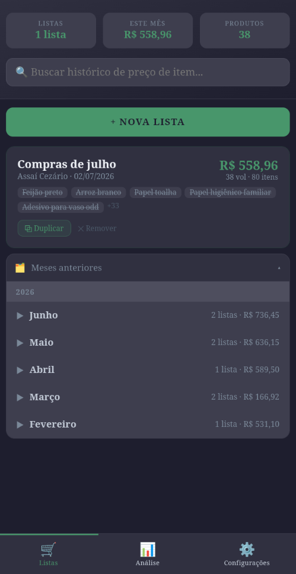
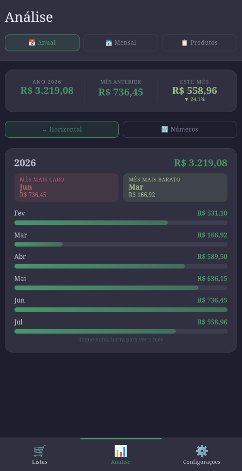
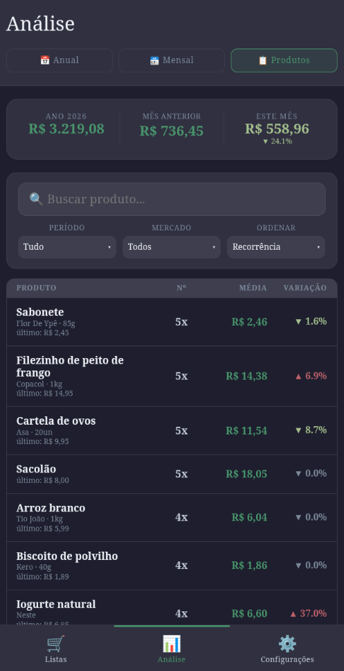
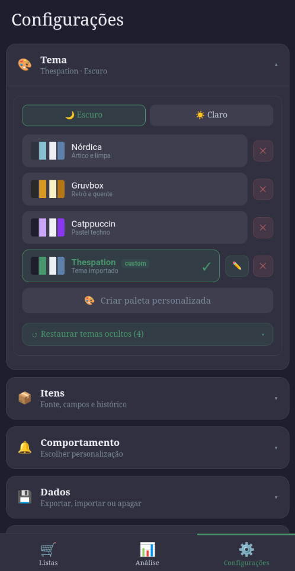
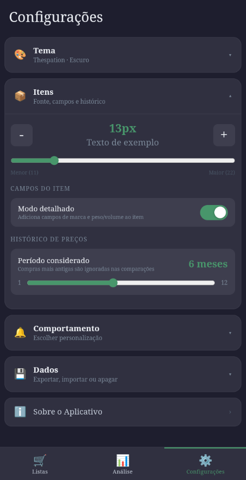
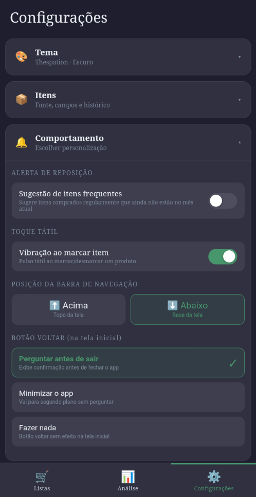
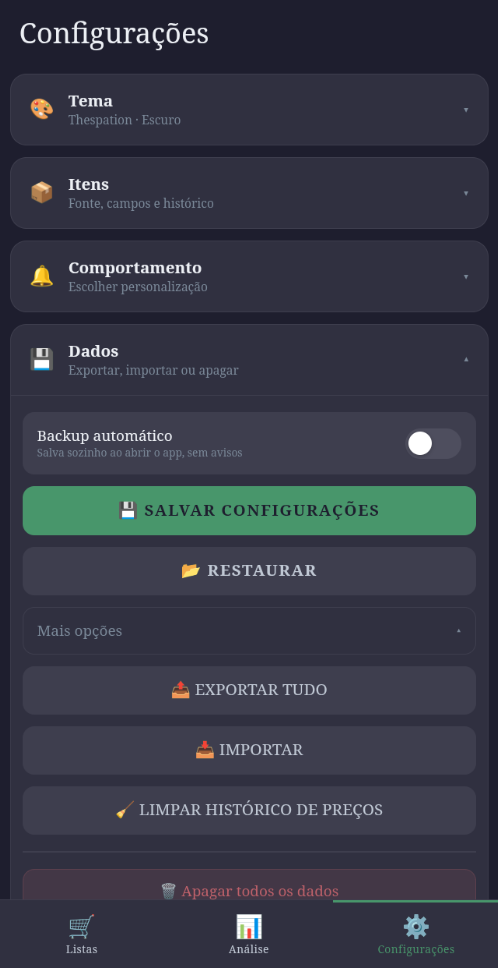
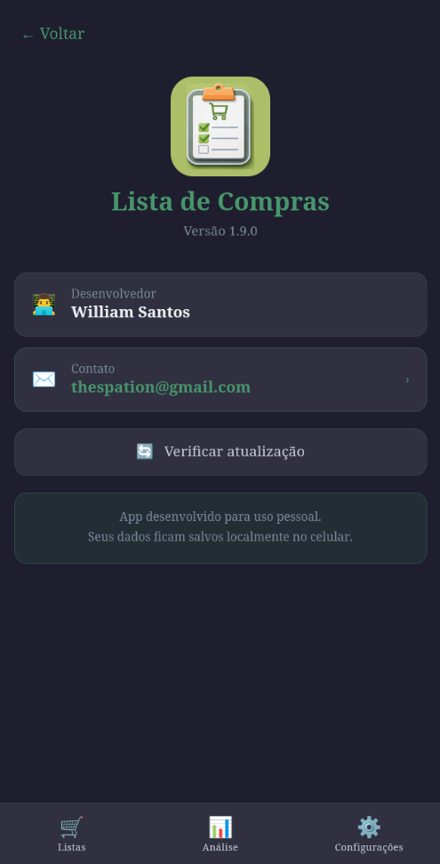

# 🛒 Shopping List

> **[🇧🇷 Ler em Português](README.md)**

<div align="center">


</div>

Native Android app for managing shopping lists with price history, spending analysis, and multiple color palettes. Works **100% offline** — no data ever leaves the phone (the only connection is the update check, which happens only when you tap the button).

---

## 📸 Screenshots

| Lists | Annual Analysis | Monthly Analysis |
|:---:|:---:|:---:|
|  |  |  |
| Summary cards, price history search, current month's lists and collapsible previous months | Yearly total, most/least expensive month and horizontal bar chart per month | Monthly total, comparison with previous month and items above historical average |

| Products Analysis | Settings — Theme | Settings — Items |
|:---:|:---:|:---:|
|  |  |  |
| Per-product history with brand/weight, purchase count, average price, variation and price timeline | Dark/Light mode, built-in and custom palettes, icon style, hide/restore themes | Font size, optional zoom, detailed mode (brand/weight) and price history period |

| Settings — Behavior | Settings — Data | About |
|:---:|:---:|:---:|
|  |  |  |
| Restock alert, haptic feedback, swipe to check, nav bar position and back button | Automatic backup and reminder, save/restore, export (backup and spreadsheet), import and storage | Version, developer, contact and update checker |

<!--
SUGGESTED NEW SCREENSHOTS (add the files to the Imagens/ folder and remove this comment to display them):

| Import — What to import? | Price timeline | Minimalist icons |
|:---:|:---:|:---:|
|  |  |  |
| Choose lists by month, palettes and settings groups before importing | Chart of a product's purchases over time, with lowest, average and highest price | Thin-line style in the theme color (dark and light) |

| Export spreadsheet (CSV) | Swipe to check | Backup reminder |
|:---:|:---:|:---:|
|  |  |  |
| Pick lists by month; save or share | Swipe an item sideways to check or uncheck it | Home-screen notice when it has been a while since the last file backup |
-->

---

## 📱 Download and Installation

1. Go to the [Releases](https://github.com/thespation/lista-compras-android/releases) page
2. Download the `app-release.apk` file
3. On Android: **Settings → Security → Install unknown apps** → enable it for your file manager
4. Open the APK and tap **Install**

> **Minimum requirement:** Android 5.1 (API 22). Some features depend on the Android version: adaptive icon (8+), monochrome/themed icon (13+).

### 🔄 Updating

- Install the new APK **over** the current version: lists, backups and settings are kept. Before updating, it is a good idea to export a backup (**Settings → Data → More options → Export everything**).
- **Starting with 1.10.4**, on the first launch after updating the app **migrates your data automatically** to a new internal address, verifying everything and deleting nothing from the old location (if anything fails, the app keeps working as before). A notice confirms when it is done.
- After migrating, **do not go back to earlier versions**: they would show the pre-migration data.
- In **Settings → Data → More options → Storage** you can see the migration status and **recover the safety copy** that Android keeps.

---

## ✨ Features

### 🛒 Shopping Lists

- **Create lists** with name, date, and selectable market
- **Editable date** — tap the header to edit name, market, and date; allows drafting lists and setting the actual purchase date later
- **Base on a previous list** — when creating a new list, copy items from an existing list with prices reset to zero
- **Future Lists** — collapsible section for lists dated in the future, with a visual indicator, kept separate from the current month
- **Organized by month** — current month expanded; previous months grouped by year/month, each collapsible
- **Duplicate list** — copies all items into a new list, with the option to reset prices and change the market
- **Markets sorted by usage** — most-used markets appear first when creating a list
- **Price history search** — search any item (by name or brand) to see its full history with date, market, price, and variation
- **Clickable "This month" card** — jumps straight to Monthly Analysis for the current month
- **Delete list** — with confirmation to prevent accidental deletion

### 📦 List Items

- **Add items** with name, quantity, and price
- **Detailed mode (optional)** — extra fields for brand and weight/volume (kg, g, L, ml, unit), with brand autocomplete and automatic capitalization
- **Bulk product editing** — in Analysis → Products, update a product's name, brand, and weight across all lists at once
- **Automatic capitalization** — names are saved with the first letter capitalized
- **Long names** — automatic line wrapping
- **Autocomplete** — suggests previously used names (with brand/weight when filled in), flags when the item is already on the list, and auto-fills brand/weight/quantity from the most recent purchase
- **Duplicate alert** — warning when adding an item already on the list
- **Automatic price comparison** — shows ▼ cheaper or ▲ more expensive compared to that product's last purchase
- **Editable quantity** — tapping the quantity field selects its value automatically
- **Spending estimate** — when items are missing a price, the total shows "≈ TOTAL"
- **Check/uncheck** purchased items with a checkbox and configurable haptic feedback
- **Swipe to check/uncheck (optional)** — swipe an item sideways, in either direction; "✓ Check" or "Uncheck" appears behind the row and only counts if you release past the threshold. Normal list scrolling is unaffected. Turn it on/off in **Settings → Behavior**
- **Edit item** — tap the pencil to fix name, quantity, price, brand, or weight
- **Sorting** by 6 criteria: insertion order, alphabetical, price, checked first/last
- **Variation filter** — show only items that got cheaper or more expensive
- **Total at top or bottom** — choose whether the checked-count+total bar stays at the top or fixed at the bottom
- **Export list** — as formatted text (grouped into "to buy"/"purchased" with subtotal) or as a file to import on another phone; both shareable via WhatsApp, email, etc.
- **Check all / Uncheck all** at once

### 📊 Spending Analysis

- **Overview card** — fixed at the top with yearly total, previous month (or last purchase), and this month with a ▲/▼ indicator
- **Yearly spending** — horizontal bar chart per month, highlighting the most and least expensive months; tap a bar to jump to that month
- **Monthly spending** — monthly total, spending per market with a visual bar, comparison with the previous period, and items above their historical average
- **Products** — price history, recurrence, variation, full market ranking by price, and filters by period/market/sorting; products with the same brand are automatically differentiated, without duplicating legacy items missing a brand
- **Price timeline** — opening a product shows a chart of all purchases in the period over time (horizontal axis proportional to the dates), with lines for lowest, average and highest price; tapping or long-pressing a point shows the date, market and price
- **Restock alert** — suggests regularly purchased items that haven't appeared this month yet; each suggestion can be dismissed individually

### ⚙️ Settings

Sections in order: **Theme → Items → Behavior → Data → About the App**

#### Theme
- **Dark/Light**
- **7 color palettes**, each with dark and light modes:
  - 🟡 **Golden** — classic and elegant
  - 🔵 **Nordic** — arctic and clean (Nord)
  - 🟤 **Gruvbox** — retro and warm
  - 🌸 **Rosé Pine** — soft and floral
  - 🟣 **Catppuccin** — pastel techno
  - ⚫ **Midnight** — OLED, absolute black `#000000`
  - 📄 **Paper** — ink on paper, pure white `#ffffff`
- **Hide themes** — ✕ button on each built-in theme; restore via a single collapsible row
- **🎨 Custom palette** — build your own palette with a live preview
- **Icons** — **Classic** (emojis) or **Minimalist** (thin-line SVG in the theme color: light on dark themes, dark on light ones, custom palettes included)
- The system bars (status and navigation) and the window background follow the chosen theme, and the app opens already in the right color, with no white flash

#### Items
- **Font size** — from 11px to 22px with a slider and +/− buttons
- **Pinch zoom** — optional, for accessibility (off by default, to avoid accidental zoom)
- **Detailed mode** — enables brand and weight/volume fields when adding or editing items
- **Price history** — how far back comparisons look (1 to 12 months)

#### Behavior
- **Suggest frequent items** — suggests regularly purchased items that aren't in the current month yet
- **Vibrate on check** — haptic pulse when checking/unchecking a product
- **Swipe to check** — turns the swipe-to-check/uncheck gesture on or off
- **Navigation bar position** — top or bottom of the screen
- **Back button** on the home screen — ask before exiting, minimize the app, or do nothing

#### Data
- **Automatic backup** — enable/disable + frequency (monthly, quarterly, biannual, yearly); runs silently when the app opens, no notifications
- **File backup reminder** — the home screen tells you when it has been 30 days since you exported a backup (or you never did and already have old lists), with "Export now" and "Remind me in 7 days"; the date of the last file backup appears here, and the reminder can be turned off
- **💾 Save settings** — local snapshot with date and time
- **📂 Restore** — list, restore, or delete saved backups
- **More options** (collapsible):
  - **📤 Export everything** — full backup; save locally or share (WhatsApp, email, Drive, etc.)
  - **📊 Export spreadsheet (CSV)** — pick the lists (by month or one by one) and save or share a file for Excel/Google Sheets: one row per item, with date, list, market, product, brand, quantity, weight/unit, unit price, total and whether it was checked (`;` separator, decimal comma, correct accents; texts that would look like formulas are protected). The spreadsheet does not count as a backup
  - **📥 Import — "What to import?"** — when importing a file (or restoring a backup), you choose what comes in:
    - **lists**, grouped by month (a whole month or list by list);
    - **custom palettes**, one by one;
    - **settings by group**: active theme (includes the icon style), hidden palettes, markets, font/tab position/zoom, behavior, restock and history, automatic backup and reminder;
    - **mode**: *add to my lists* or *replace all my lists*; for lists that already exist: *skip*, *replace* or *import as a copy*;
    - shows a summary before confirming and always saves an automatic backup of the current data; files with invalid parts don't break the app (whatever is unusable is ignored and you are told)
  - **Storage** — app address, data migration status and **Recover migration copy** (opens "What to import?" with the safety copy Android keeps)
- **🗑 Delete all data** — automatically backs up before deleting, with confirmation

### ♿ Accessibility
- **TalkBack and keyboard** — item checkboxes with state and name (also Space/Enter), edit buttons named after the item, ✕ buttons named after their action, collapsible sections that announce whether they are open or closed, and decorative emojis hidden from screen readers
- Optional **pinch zoom** and adjustable **font size**
- **Icons** — adaptive (Android 8+) and monochrome for "themed icons" (Android 13+)

### 🔄 Updates
- **"Check for update"** button on the About screen — checks GitHub (comparing version numbers) and shows the changelog with formatting (bold, headings, lists)
- One-tap download of the latest APK
- Manual check only, no background data usage

---

## 🛠️ Building the project

Requirements: a recent **Android Studio** (or JDK 17–21 + Android SDK 34) and internet on the first build (to download dependencies). The full guide, with fixes for the most common errors, is in [`COMO-COMPILAR.txt`](COMO-COMPILAR.txt) (in Portuguese).

1. Open the **`android`** folder in Android Studio.
2. **Gradle JDK**: in *Settings → Build, Execution, Deployment → Build Tools → Gradle*, pick **jbr-21** (or a JDK 17/21). A newer JDK (such as 25) causes the *"Incompatible Gradle JVM version"* error with Gradle 8.5.
3. **Signing**: the project signs both `debug` and `release` with the same key, which is **not in the repository**. Create your own:
   ```bash
   keytool -genkeypair -v -keystore android/keystore/lista-compras-release.keystore -alias lista-compras -keyalg RSA -keysize 2048 -validity 10000
   ```
   and create `android/keystore/keystore.properties` with `storePassword=...`, `keyAlias=lista-compras` and `keyPassword=...` (or set the `LC_KEYSTORE_PASSWORD` environment variable). Both files stay out of git (`.gitignore`). An APK signed with a different key **cannot update over** the official APK: you have to uninstall first.
4. Build the APK (inside the `android` folder):
   ```bash
   ./gradlew assembleRelease      # Windows: gradlew.bat assembleRelease
   ```
   The file is produced at `android/app/build/outputs/apk/release/app-release.apk` (release uses R8; `assembleDebug` produces an unoptimized APK).

> The `index.html` in `assets/public` is the compiled result of `src/App.jsx` (React 18 + esbuild, as a single file). The script that generates it is not part of this repository.

---

## 🗂️ Project Structure

```
lista-compras-android/
├── android/                          # Android Studio project
│   ├── app/
│   │   ├── build.gradle              # Module config (AGP 8.3.2, compileSdk 34), R8 in release and signing
│   │   ├── proguard-rules.pro        # Protects the JavaScript ↔ Java bridge from R8
│   │   └── src/main/
│   │       ├── AndroidManifest.xml   # Permissions: INTERNET and VIBRATE; FileProvider for sharing
│   │       ├── assets/public/
│   │       │   └── index.html        # Full app bundled inline (generated from src/App.jsx)
│   │       ├── java/com/listacompras/app/
│   │       │   ├── MainActivity.java # WebView, WebViewAssetLoader and AndroidBridge
│   │       │   └── MigrationStore.java # Verified copy of the data during migration
│   │       └── res/
│   │           ├── mipmap-*/         # Icons (regular, round, adaptive and monochrome)
│   │           ├── mipmap-anydpi-v26/# Adaptive icon definition
│   │           ├── values/           # Colors and theme (no status bar interference)
│   │           └── xml/              # FileProvider configuration
│   ├── gradle/wrapper/               # Gradle Wrapper (Gradle 8.5)
│   ├── gradlew, gradlew.bat          # Build without installing Gradle
│   └── keystore/                     # Signing key (not versioned — see .gitignore)
├── src/
│   └── App.jsx                       # React source code
├── Imagens/                          # App screenshots
├── COMO-COMPILAR.txt                 # Build guide and troubleshooting (Portuguese)
├── README.md                         # Portuguese version
└── README_EN.md                      # This file (English)
```

---

## 🔧 Technologies Used

| Technology | Version | Purpose |
|---|---|---|
| **React** | 18.x | User interface |
| **JavaScript (JSX)** | ES2017+ | App logic |
| **esbuild** | latest | Bundler — compiles and minifies the JSX |
| **Android WebView** | — | Native container for the web app |
| **Java** | 17 | MainActivity, AndroidBridge, MigrationStore, FileProvider |
| **Gradle** | 8.5 | Android build system (JDK 17–21) |
| **Android Gradle Plugin** | 8.3.2 | Android build plugin |
| **AndroidX Core** | 1.12.0 | FileProvider support (file sharing) |
| **AndroidX WebKit** | 1.10.0 | WebViewAssetLoader (the app's internal https address) |
| **R8** | — | Shrinks the release APK |
| **localStorage** | Web API | Data and backup persistence |

> No external UI frameworks, no database, no server. Data stored 100% on the device.

---

## 🏗️ Architecture

The app is a React **Single Page Application (SPA)** bundled with esbuild into a single `index.html` file. That file is loaded by a native Android `WebView`.

### Internal address and data migration

Starting with 1.10.4 the app is served by `WebViewAssetLoader` at `https://appassets.androidplatform.net/assets/public/index.html` (an internal address, no internet; earlier versions used `file:///android_asset/...`). Since `localStorage` is separate per address, on the first launch the data is **copied** from the old address to the new one:

1. on the old address, the app reads every key and hands it to Android, which writes a copy to a file (`MigrationStore`, atomic write) and **verifies** it;
2. only then does it open the new address and import the copy **without overwriting** anything that already exists, verifying each key; if anything fails, everything is undone and the app returns to the old address (up to 3 attempts);
3. nothing is deleted from the old address, and the copy stays stored by Android (recoverable in *Data → More options → Storage*).

### Product identification

Products are grouped by name; brand and weight/volume only distinguish products when there's an actual conflict between filled-in values (two different brands, for example). Items with no brand set (legacy entries or simple mode) are automatically merged into the matching product, avoiding duplicates in Analysis. Price history is computed from the lists themselves.

### Java ↔ JavaScript Bridge

```javascript
window.__androidDarkMode             // boolean — Android system theme
window.__androidBack                 // function — back button handler
window.__flushSave                   // function — saves data right away (Android calls it in onPause)
window.__onFilePicked(content)       // Android delivers the content of the chosen file
window.__onFileSaved                 // Android reports that a file backup was written
window.AndroidBridge.openUrl(url)    // opens URL in external browser (http, https and mailto only)
window.AndroidBridge.exitApp()       // closes the app
window.AndroidBridge.minimizeApp()   // minimizes to background
window.AndroidBridge.vibrate(ms)     // haptic feedback
window.AndroidBridge.share(text)     // native text sharing
window.AndroidBridge.shareFile(name, content)           // backup (JSON) as a real file (via FileProvider)
window.AndroidBridge.shareTextFile(name, mime, content) // CSV spreadsheet or text as a file
window.AndroidBridge.saveFile(name, content)            // Android's "Save as" picker (backup)
window.AndroidBridge.saveTextFile(name, mime, content)  // "Save as" for CSV or text
window.AndroidBridge.pickFile()      // opens the file picker for imports
window.AndroidBridge.setThemeColors(bg, nav, dark)      // system bars and window background colors
window.AndroidBridge.migrationStatus() // + migrationExport/Get/Done/Info/...: data migration (1.10.4+)
```

### Persistence (localStorage)

| Key | Content |
|---|---|
| `lista-compras-v2` | Lists and items |
| `lista-compras-settings` | User settings |
| `lista-compras-backups` | Internal backup index |
| `lista-compras-backup-{timestamp}` | Data for each individual backup |
| `lista-compras-migracao` | Data migration marker (1.10.4+) |

---

## 🎮 Navigation — Back Button (Android)

Cascading behavior:
1. Closes any open modal or dropdown
2. Closes any expanded accordion in Settings
3. Collapses expanded details in Analysis → Products
4. Inside a list → back to Lists
5. In Analysis or Settings → back to Lists
6. On the About screen → back to Settings
7. On the home screen → configurable behavior (ask, minimize, or nothing)

---

## 👨‍💻 Developer

**William Santos**
- GitHub: [@thespation](https://github.com/thespation)
- Email: thespation@gmail.com

---

## 📄 License

This project is for personal use. Feel free to use it as a reference or as a base for your own projects.
